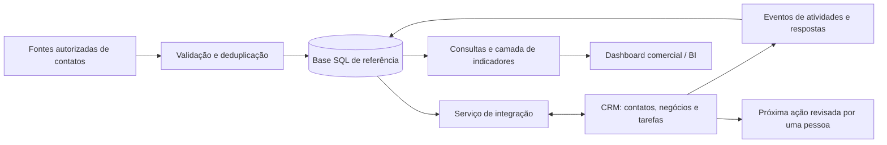

# Arquitetura de referência: dados, CRM e indicadores

Este documento explica uma **arquitetura genérica proposta**, não uma integração implementada neste repositório nem a arquitetura de uma empresa real. A demonstração executável usa JavaScript, dados sintéticos e armazenamento local no navegador. Não há conexão SQL, OAuth, API do HubSpot, sincronização ou envio de mensagens.

## Visão geral



O desenho representa fluxos lógicos. Uma implementação real precisaria definir quais dados pertencem a cada sistema e os contratos de sincronização; não basta conectar duas ferramentas e escrever os mesmos campos em ambas.

## Papel de cada componente

| Componente | Responsabilidade de referência |
| --- | --- |
| SQL | Identificadores estáveis, histórico de eventos, vínculos entre registros e consultas analíticas |
| HubSpot ou outro CRM | Acompanhamento do relacionamento, negócios, responsáveis e tarefas comerciais |
| Serviço de integração | Traduzir campos, relacionar IDs, validar alterações e registrar falhas; credenciais ficam exclusivamente no servidor |
| Canais de contato | Produzir eventos de atividades e respostas por meios autorizados; uma pessoa decide a continuidade |
| BI | Calcular indicadores com definições consistentes de período, coorte e denominador |

SQL é uma linguagem de consulta, e não um produto único. Este projeto não pressupõe um fornecedor de banco de dados. HubSpot é citado como exemplo de CRM, sem afiliação ou integração ativa.

## Entidades ilustrativas

- `contacts`: contato fictício, função, resumo, senioridade e hipótese de aderência.
- `accounts`: empresa fictícia e segmento.
- `activities`: contato, canal, tipo de evento, data e identificador único do evento.
- `opportunities`: conta, etapa, valor ilustrativo, abertura e fechamento.
- `tasks`: responsável, próximo passo, prazo e conclusão.
- `external_ids`: relação entre identificadores locais e do CRM.

**Contato, atividade, reunião e oportunidade são entidades diferentes.** Várias atividades podem se referir à mesma pessoa; uma oportunidade pode ter vários interlocutores. Isso evita confundir volume de mensagens com alcance ou receita.

## Exemplo de consulta SQL

Consulta ilustrativa em sintaxe PostgreSQL. Não é executada pela aplicação. Os parâmetros representam limites de um período, com início inclusivo e fim exclusivo.

```sql
SELECT
  COUNT(*) AS outreach_activities,
  COUNT(DISTINCT contact_id) AS contacts_reached
FROM activities
WHERE event_type = 'outreach_sent'
  AND occurred_at >= :period_start
  AND occurred_at < :period_end;
```

Um contato abordado por e-mail e LinkedIn gera duas atividades e um contato alcançado. Para contar respostas sem distorção, seria necessário definir a coorte de contatos alcançados e relacionar as respostas a ela, em vez de dividir eventos de períodos incompatíveis.

## Como uma atualização poderia funcionar

1. Um contato elegível recebe um ID local; a deduplicação considera identificadores profissionais e revisão de possíveis homônimos.
2. A integração cria ou atualiza o registro no CRM e salva o ID externo.
3. Uma resposta gera um evento único. A regra individual de pausa impede próximos envios da cadência desse contato; ela não bloqueia automaticamente toda a empresa.
4. Uma pessoa qualifica a resposta e registra a próxima tarefa. Interesse não significa automaticamente oportunidade ganha.
5. Os eventos são consolidados no SQL e alimentam consultas de indicadores. Reuniões agendadas, realizadas e contratos assinados têm eventos e datas próprios.

Para implementação real, seriam necessários autenticação, permissões, consentimentos aplicáveis, tratamento de limites de API, retentativas, idempotência, logs sem dados sensíveis, exclusão e retenção de dados. Essas capacidades não são prometidas pela demonstração atual.

## O que está implementado aqui

| Capacidade | Situação |
| --- | --- |
| Jornada comercial completa com critérios de avanço | Simulação funcional |
| CRM, cadência, respostas e pipeline | Simulação local com dados fictícios |
| Indicadores e premissas de custo | Cálculos funcionais sobre cenários sintéticos |
| Integração SQL ↔ HubSpot | Arquitetura de referência documentada; não implementada |
| Envio real por LinkedIn, e-mail ou WhatsApp | Não implementado |
| Assinatura, faturamento ou gestão de entrega | Etapas explicadas; não executadas |

Os dois cenários demonstrativos (CRM e dashboard trimestral) são independentes. Uma alteração em um deles não se propaga ao outro.
